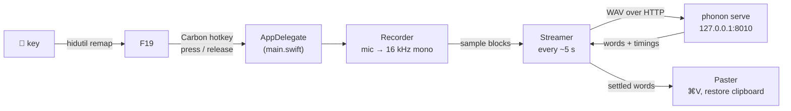

# Phonon Dictation

Hold the 🎤 (Dictation) key on your Mac, talk, and your words are typed into whatever app you're in, transcribed on your Mac by a local speech model.

Phonon Dictation is a small Swift menu-bar app that replaces Apple Dictation on the 🎤 key with [Phonon-2](https://github.com/fermionresearch/phonon) (164 MB, English). Recognition runs on a `phonon serve` process that only listens on `127.0.0.1`. No audio leaves the Mac, and nothing is logged or saved.

## Features

- **Two key modes.** Hold 🎤 to talk, or press it to start and press again to stop. You pick the mode in the menu-bar menu, and the app remembers it.
- **Streaming output.** Text is pasted about every 5 seconds while you talk, and the rest is pasted when you stop.
- **Spoken cues.** A voice says "Start" when the app begins listening and "Stop" when it stops. You can turn them off in the menu.
- **Keeps your clipboard.** Text is pasted with ⌘V, then your previous clipboard contents are put back. The temporary entry is marked so clipboard-history tools can ignore it.
- **Guided permissions.** If Microphone or Accessibility access is missing when you press 🎤, the app shows the macOS prompt or opens the right page in System Settings.
- **Start at Login**, from the menu (uses macOS Login Items).
- **No extra keyboard utilities.** The key remap uses macOS's own `hidutil`, and the hotkey needs no Input Monitoring permission.

## How it works



| Piece | File |
|---|---|
| Menu-bar app: menu, key modes, spoken cues, permissions, Start at Login; starts and stops everything | `Sources/main.swift` |
| Remaps 🎤 → F19 with `hidutil` and listens for F19 press and release | `Sources/HotKey.swift` |
| Microphone → 16 kHz mono, muted for the length of the "Start" cue | `Sources/Recorder.swift` |
| Decides which words are final and when to paste them | `Sources/Streamer.swift` |
| Runs (or reuses) `phonon serve` on 127.0.0.1:8010 and sends it audio | `Sources/Transcriber.swift` |
| Pastes with ⌘V, then restores your clipboard | `Sources/Paster.swift` |

**The 🎤 key.** On launch the app remaps the Dictation key (HID usage `0x0C/0xCF`) to F19, so Apple Dictation never sees it, and catches F19 with a Carbon hotkey. This hotkey needs no Input Monitoring permission. The remap lasts until logout, and quitting the app removes it, which gives the key back to Apple Dictation.

**The Phonon server.** At launch the app checks for a server answering on `http://127.0.0.1:8010/v1/models`. If there is none, it starts `phonon serve --port 8010` from the project's `.venv` (the path is written into the app's `Info.plist` by `build.sh`) and waits up to 3 minutes for it. It then sends one short silent clip so the first real dictation doesn't pay the warm-up cost. The server's output is discarded. Audio is posted to the OpenAI-style `/v1/audio/transcriptions` endpoint with word-level timestamps. The app stops the server when it quits, if it started it.

**Streaming.** About every 5 seconds the app transcribes the audio and pastes the new words that end more than 1 second before the end. Those words have enough context to be final. When you stop, the rest is pasted. Because word timings shift slightly between passes, the boundary is aligned against the last words already pasted, so words are not doubled or lost.

Each pass transcribes from where you started talking, or from your last pause of at least 0.3 s. It never starts in the middle of speech, because Phonon-2 often skips a whole sentence when a clip does that (about 1 in 5 clips in testing). Audio from before a pause is dropped once a dictation passes 20 seconds, so each pass stays fast.

**Spoken cues.** `build.sh` generates "Start" and "Stop" with macOS `say`. The mic would hear "Start" and Phonon would type it, so each recording stays muted until the word ends, plus 0.2 s for speaker delay (about 0.55 s in total). "Stop" plays after the mic is off.

**Cleanup.** Half a second of silence goes after each clip, because without it Phonon tends to invent a final "but" or "and". Words heard in near-silence are dropped, because the model sometimes invents an "Okay." there.

## Requirements

- A Mac with Apple silicon (the app is built for `arm64`) running macOS 14 or later
- Apple's command line tools (`swiftc`, `codesign`)
- Python 3 for the Phonon environment (tested with Homebrew Python 3.13)
- About 164 MB of disk for the Phonon-2 model

## Installation

```bash
git clone <this repo> && cd phonon-dictation
/opt/homebrew/bin/python3.13 -m venv .venv        # tested with Homebrew Python 3.13
.venv/bin/pip install fermion-research mlx mlx-audio mlx-lm soundfile scipy zstandard
xcode-select --install                            # if you don't have Apple's command line tools
scripts/create-signing-identity.sh                # local signing certificate, so permissions survive rebuilds
./build.sh                                        # builds and installs ~/Applications/Phonon Dictation.app
open ~/Applications/"Phonon Dictation.app"        # first launch downloads the model (164 MB)
```

`build.sh` stops with an error if `.venv/bin/phonon` is missing. It compiles `Sources/*.swift` with `swiftc`, writes the app bundle to `build/`, signs it, and copies it to `~/Applications`, quitting and reopening the app if it was running.

**Signing.** `scripts/create-signing-identity.sh` makes a self-signed code-signing certificate named "Phonon Dictation Local Signing" in your login keychain, and `build.sh` signs with it. macOS ties permissions to the app's signature. With the certificate the signature stays the same across rebuilds, so you only grant permissions once. Without it, the app is signed ad hoc, and every rebuild looks like a new app that needs the permissions again. If signing fails with `errSecInternalComponent`, unlock your login keychain and run `./build.sh` again. To remove the certificate, delete it in Keychain Access.

**Permissions.** The app needs **Microphone** and **Accessibility** access (Accessibility lets it paste). If either is missing when you press 🎤, the app asks for it then and there: it shows the macOS prompt or opens the right page in System Settings. Then press 🎤 again.

## Usage

1. Wait until the menu-bar status line changes from "Loading Phonon-2…" to "Ready".
2. Click into any text field.
3. Hold 🎤 and talk (or, in press-to-start mode, press 🎤, talk, and press it again).
4. Text appears as you go; the rest is pasted when you stop.

The menu-bar icon turns into a red filled microphone while recording. If you press 🎤 before the server is ready, the Mac beeps.

Menu items:

| Item | What it does |
|---|---|
| Status line | Shows loading, ready, recording, and error messages |
| Hold 🎤 to Talk | Record while the key is held (default) |
| Press 🎤 to Start, Press Again to Stop | Toggle recording with each press |
| Say "Start" and "Stop" | Turns the spoken cues on or off (on by default) |
| Start at Login | Adds or removes the app from Login Items |
| Quit Phonon Dictation | Quits, stops the server it started, and gives 🎤 back to Apple Dictation |

## Configuration

Settings chosen in the menu are stored in the app's user defaults (bundle ID `local.phonon-dictation`):

| Key | Values | Default |
|---|---|---|
| `KeyMode` | `hold`, `toggle` | `hold` |
| `PlaySounds` | `true`, `false` | `true` |

There is no config file or environment variable. Other behaviour is set by constants in the source:

| Setting | Value | Where |
|---|---|---|
| Phonon server port | 8010 | `PhononServer.port` in `Sources/Transcriber.swift` (also hard-coded in `Tests/`) |
| Seconds between passes | 5 | `passSeconds` in `Sources/Streamer.swift` |
| Seconds before the end that words wait for the next pass | 1 | `settleSeconds` in `Sources/Streamer.swift` |
| Dictation length after which old audio is trimmed | 20 s | `trimAfterSeconds` in `Sources/Streamer.swift` |
| Path to `phonon` | `<repo>/.venv/bin/phonon` | `PhononCommand` in `Info.plist`, written by `build.sh` |

## Testing

```bash
Tests/run.sh
```

This generates speech with macOS `say`: normal and fast speech, a meeting-style monologue, a 55-second dictation, a short note, and a sentence followed by an 8-second pause. It streams each clip through `Streamer` in 100 ms blocks, the same code the app uses, and compares the pasted text with one transcription of the whole clip. A clip fails if more than 2 words differ (lost, doubled or invented words). It uses the app's Phonon server if the app is running, or starts one from `.venv`. The test needs macOS and the `.venv` from the installation steps.

## Project structure

```
.
├── Sources/
│   ├── main.swift          # menu-bar app and dictation lifecycle
│   ├── HotKey.swift        # 🎤 → F19 remap and Carbon hotkey
│   ├── Recorder.swift      # microphone capture at 16 kHz mono
│   ├── Streamer.swift      # chunked transcription and paste decisions
│   ├── Transcriber.swift   # Phonon server management and HTTP client
│   └── Paster.swift        # ⌘V paste with clipboard restore
├── Tests/
│   ├── main.swift          # streaming test harness
│   └── run.sh              # builds the harness and runs it on generated speech
├── scripts/
│   └── create-signing-identity.sh
└── build.sh                # builds, signs and installs the app
```

## Limitations

- **Personal project, built locally.** There are no prebuilt releases; you build it from source with the steps above.
- **Tied to the Phonon install.** The app runs `phonon` by the absolute path baked in at build time (this repository's `.venv` by default, or `PHONON=/path/to/phonon ./build.sh`), so moving or deleting it breaks the app until you rebuild.
- **Apple silicon and English only**, following the target and the Phonon-2 model.
- **Fixed port.** The app uses port 8010 and reuses whatever answers there with HTTP 200 on `/v1/models`.
- **Remap after a crash.** If the app exits without quitting normally, the 🎤 → F19 remap stays until you log out or relaunch and quit the app.
- **Pasting uses the clipboard.** Text is inserted with a simulated ⌘V, so it only works where pasting works.
- **Tests are end-to-end only.** They need macOS, `say` and a running Phonon model; there are no unit tests or CI.

## License

No license file yet — all rights reserved.
